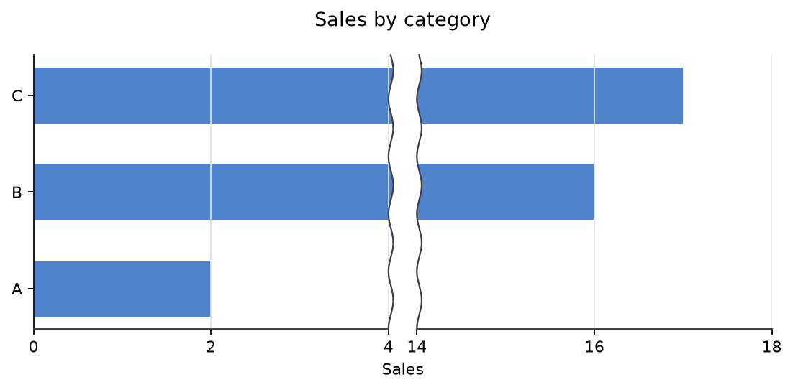
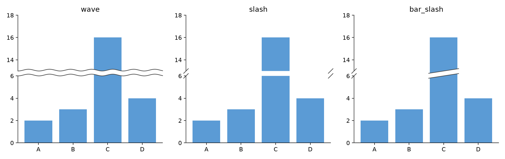

# matplotlib-omission

Matplotlib の棒グラフで、値軸の途中を省略できる Python ライブラリです。

## インストール

PyPI 公開後は次のコマンドでインストールできます。

```bash
pip install matplotlib-omission
```

## 動作環境

Python 3.10 以降、Matplotlib 3.8 以上 4 未満、NumPy 1.24 以上に対応しています。

## 使い方

`enable()` を呼び出した後、`ax.set_xlim()` に表示範囲、目盛り間隔 `step`、省略範囲 `omit` を指定します。

```python
import matplotlib.pyplot as plt
import matplotlib_omission

matplotlib_omission.enable()

fig, ax = plt.subplots(figsize=(7, 3.5))
ax.barh(["A", "B", "C"], [2, 16, 17], color="#4f83cc", height=0.58)
ax.set_xlim(0, 18, step=2, omit=(4, 14), break_style="wave", gap=0.08)
ax.set_title("Sales by category", pad=18)
ax.set_xlabel("Sales")
ax.grid(axis="x", color="#dbe2ea", linewidth=0.8)
fig.tight_layout()
plt.show()
```

出力例：



切断記号の間隔は `gap` で調整できます。値を小さくすると間隔が狭くなり、縦棒グラフの `ax.set_ylim()` でも使えます。

省略部分の表示は `break_style` で選べます（既定値は `wave`）。上の `ax.set_xlim()` の行を、例えば次のように変更します。

```python
ax.set_xlim(0, 18, step=2, omit=(4, 14), break_style="slash", gap=0.08)
```

`wave` は波線、`slash` は軸の斜線、`bar_slash` は軸と棒の切断辺に斜線を描きます。出力比較：



## FAQ

**Q. 縦棒グラフでも使えますか？** 使えます。`ax.bar()` で棒を描き、`ax.set_ylim(..., omit=(開始, 終了))` を指定してください。

**Q. 複数の区間を省略できますか？** できます。`omit=[(4, 7), (10, 14)]` のように指定してください。

## 制限事項

- `twinx()` / `twiny()` で作成した副軸では、省略を正しく描画できない場合があります。副軸に省略を設定すると元のグラフが隠れ、主軸に設定すると副軸の描画が省略部分を貫通することがあります。
- 共有する軸に両方から省略を設定すると、縮尺と切断位置がずれることがあります。省略を設定した副軸では、右側または上側の軸線が消える場合もあります。
- 省略を設定した方向で後から `sharex()` / `sharey()` を呼んでも、共有先には切り抜きや切断記号が引き継がれず、描画が隙間を貫通します。逆に省略済みの軸から通常の軸を共有すると、縮尺が置き換わって切断位置がずれることがあります。
- 共有した値軸の範囲を後から変えても切断位置がずれます。軸の共有は省略設定より前に行い、各軸に省略表示が自動で引き継がれるとは想定しないでください。
- 省略する軸の `set_xticks()` / `set_yticks()` は、それぞれ `set_xlim(..., omit=...)` / `set_ylim(..., omit=...)` の後に呼んでください。先に指定した目盛りとラベルは省略設定時に上書きされます（`step` 指定時も同様です）。
- 独自の目盛りは表示区間内かつ軸範囲内の値に限ってください。省略区間内の目盛りは除外されず、軸範囲外の目盛りは範囲を広げて切断位置をずらします。

## ライセンス

[MIT License](https://github.com/magichan-lab/matplotlib-omission/blob/main/LICENSE)
Copyright (c) 2026 magichan (https://github.com/magichan-lab)
