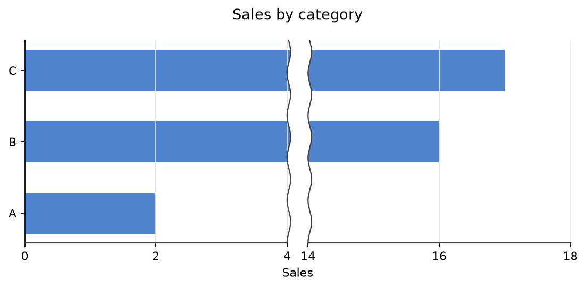
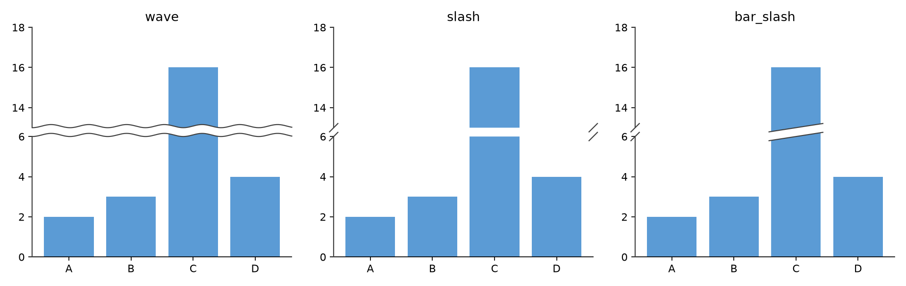

# matplotlib-omission

Create bar charts with a break in the value axis using Matplotlib.

[Japanese README](https://github.com/magichan-lab/matplotlib-omission/blob/main/README.ja.md)

## Installation

Once published on PyPI, install it with:

```bash
pip install matplotlib-omission
```

## Requirements

Python 3.10 or later, Matplotlib 3.8 or later (but below 4), and NumPy 1.24 or later.

## Quick start

Call `enable()`, then use `ax.set_xlim()` to set the axis limits, tick interval (`step`), and omitted interval (`omit`).

```python
import matplotlib.pyplot as plt
import matplotlib_omission

matplotlib_omission.enable()

fig, ax = plt.subplots(figsize=(7, 3.5))
ax.barh(["A", "B", "C"], [2, 16, 17], color="#4f83cc", height=0.58)
ax.set_xlim(0, 18, step=2, omit=(4, 14), break_style="wave", gap=0.08)
ax.set_title("Sales by category", pad=18)
ax.set_xlabel("Sales")
ax.grid(axis="x", color="#dbe2ea", linewidth=0.8)
fig.tight_layout()
plt.show()
```

Example output:



Use `gap` to adjust the space between the two break marks; smaller values bring them closer. It also works with `ax.set_ylim()` for vertical bars.

Set `show_break_tick_labels=False` in `set_xlim()` or `set_ylim()` to hide the numbers at the break boundaries.

Choose how the break appears with `break_style` (default: `wave`). For example, replace the `ax.set_xlim()` line above with:

```python
ax.set_xlim(0, 18, step=2, omit=(4, 14), break_style="slash", gap=0.08)
```

`wave` draws wavy lines, `slash` draws slashes on the axis, and `bar_slash` also draws slanted cuts across the bars. Comparison:



## FAQ

**Q. Can I use it with vertical bars?** Yes. Draw the bars with `ax.bar()` and specify the omitted interval with `ax.set_ylim(..., omit=(start, end))`.

**Q. Can I omit multiple intervals?** Yes. Use `omit=[(4, 7), (10, 14)]`.

## Limitations

- Twin axes created with `twinx()` or `twiny()` do not currently render breaks reliably. A break on the twin can cover the original plot; a break on the original axis does not clip artists on the twin, so they may cross the gap.
- Setting breaks on both axes along their shared dimension can misalign the scale and break marks. The twin's right or top spine may also disappear when the break is set on that twin.
- Calling `sharex()` or `sharey()` on an omitted dimension does not transfer its clipping or break marks to the other axes, so their data can cross the gap. If the omitted axes instead share from ordinary axes, their scale can be replaced while the break marks remain in place.
- Changing the shared limits after setting a break can also misalign its marks and data. Set up shared axes before configuring breaks, and do not rely on a break in one axes to apply to the others.
- On an omitted axis, call `set_xticks()` after `set_xlim(..., omit=...)`, or `set_yticks()` after `set_ylim(..., omit=...)`. Setting the break replaces earlier custom ticks and labels, including when `step` is used.
- Keep custom ticks within the visible intervals and axis limits. Ticks inside an omitted interval are not filtered out; ticks outside the limits expand the axis and misalign the break marks.

## License

[MIT License](https://github.com/magichan-lab/matplotlib-omission/blob/main/LICENSE)
Copyright (c) 2026 magichan (https://github.com/magichan-lab)
